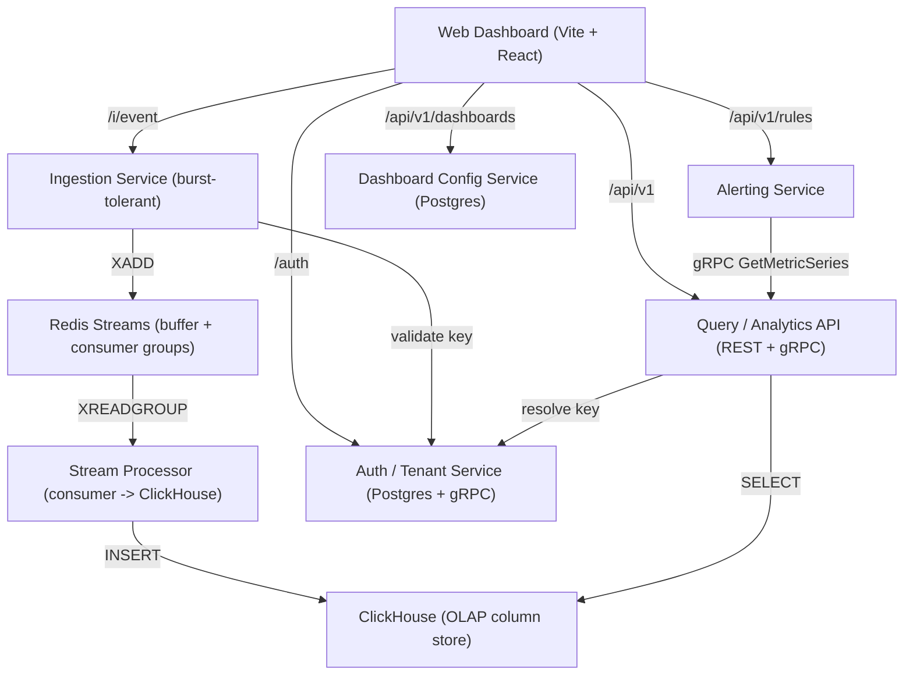

# Nimbus Analytics — Self-Hosted Product Analytics Platform

Privacy-first, self-hosted product analytics in the PostHog/Plausible category, built
for GDPR-conscious teams who refuse to ship event data to a third party. Every
component runs in your own infrastructure.

This is a **NestJS microservices monorepo** with a real OLAP backbone: events are
ingested through a burst-tolerant stream buffer, aggregated in near real time by
ClickHouse materialized views, and served to a dashboard through a REST + gRPC
surface. The architecture deliberately demonstrates **data engineering fused with
backend development** — the rare combination of building column-store time-series
pipelines and the surrounding product services.

## Architecture



### Services

| Service | Directory | Role | Tech |
| --- | --- | --- | --- |
| **Auth / Tenant** | `services/auth` | Users, orgs, projects, API keys; validates keys over gRPC | NestJS, Prisma, Postgres, JWT |
| **Ingestion** | `services/ingestion` | `POST /i/event`, validates + enriches events, coalesced writes | NestJS, ioredis, Redis Streams |
| **Stream Processor** | `services/stream-processor` | Consumer-group reader → ClickHouse with dedup, retries, dead-letter | NestJS, ioredis, ClickHouse client |
| **Query / Analytics API** | `services/query-api` | Overview, funnels, retention, events, metric series (REST + gRPC) | NestJS, ClickHouse |
| **Alerting** | `services/alerting` | Threshold rules evaluated via gRPC; webhook delivery | NestJS, Redis |
| **Dashboard Config** | `services/dashboard-config` | Dashboards + panels CRUD (the query layer is in query-api) | NestJS, Prisma, Postgres |
| **Web Dashboard** | `web` | Login, overview, funnels, retention, events, dashboards, alerts, settings | React, Vite, Recharts |

### Shared library — `libs/shared`

Everything the services agree on lives here so contracts never drift:

- `event.ts` — the wire event model (`CaptureEvent` → `AnalyticsEvent` → `EnrichedEvent`)
- `schema.ts` — the canonical ClickHouse DDL (events, `hourly_events` + materialized view, sessions, event_names)
- `config.ts` — single source of truth for env-driven configuration
- `redis.ts` / `clickhouse.ts` / `grpc.ts` — connection factories
- `logger.ts` — structured logging (JSON in prod, readable in dev)

`proto/analytics.proto` defines the internal gRPC contracts: `Auth.ValidateApiKey`
(used by ingestion + query-api) and `AnalyticsQuery.*` (used by alerting).

## Why ClickHouse

The analytics store is the differentiator. Postgres (OLTP) holds relational config —
users, projects, dashboards. ClickHouse (OLAP) holds **append-only columnar event
data** optimized for range scans over `(project_id, event_name, timestamp)`:

- `ReplacingMergeTree` collapses duplicate `event_id` rows at merge time, making the
  pipeline idempotent on top of at-least-once delivery.
- `AggregatingMergeTree` + a materialized view maintain **per-hour distinct-user
  state** (`uniqExactState`) in the background — counting events/users never rescans
  raw rows.
- `windowFunnel` computes ordered multi-step conversion natively.
- A 12-month TTL bounds storage cost automatically.

## Quick start (local, no Docker)

Requires Node ≥ 20 and local `redis-server`, `postgresql`, and `clickhouse-server`.

```bash
# 1. Install dependencies
npm install

# 2. Start infra (redis, postgres, clickhouse) and create databases
./scripts/run-infra.sh

# 3. Run Prisma migrations + create the ClickHouse schema
npm run db:init

# 4. Start every service + the web dashboard
./start.sh

# (alternative) run services individually
npm run dev:auth
npm run dev:ingestion
npm run dev:stream
npm run dev:query
npm run dev:alerting
npm run dev:dashboards
npm run dev:web
```

Open the dashboard at `http://localhost:5173`, create an account, and start sending
events. A demo project with ingestion + query API keys is created automatically on
registration.

### Seed with synthetic data

With all services running:

```bash
npm run db:seed
```

This registers a demo user, streams ~90 days of realistic product events (pageviews,
signups, feature clicks, purchases across 1,500 synthetic users), and provisions a
dashboard and an alert rule.

## Quick start (Docker)

```bash
# Infrastructure only (redis, postgres, clickhouse)
docker compose up -d redis postgres clickhouse
npm run db:init
npm run dev:all

# Or the entire stack including services in containers
docker compose up -d --build
```

The web container (port 5173) reverse-proxies `/auth`, `/i`, `/api/v1/dashboards`,
`/api/v1/rules`, and `/api/v1` to the right backend services — a single exposed port,
matching the online preview constraint.

## API surface (external, REST)

| Method | Path | Service | Auth |
| --- | --- | --- | --- |
| POST | `/auth/register` | auth | — |
| POST | `/auth/login` | auth | — |
| GET | `/auth/me` | auth | JWT |
| POST | `/i/event` | ingestion | `x-api-key` (ingestion key) |
| GET | `/api/v1/overview` | query-api | `x-api-key` (query key) |
| GET | `/api/v1/metrics/series` | query-api | query key |
| GET | `/api/v1/funnel` | query-api | query key |
| GET | `/api/v1/retention` | query-api | query key |
| GET | `/api/v1/events` | query-api | query key |
| GET | `/api/v1/event-names` | query-api | query key |
| GET/POST | `/api/v1/dashboards` | dashboard-config | — |
| GET/POST | `/api/v1/rules` | alerting | — |

Query endpoints accept a query key either as `Authorization: Bearer <key>` or
`x-api-key`. Full query params are documented in the service DTOs.

## Ingestion wire format

```json
POST /i/event
{
  "api_key": "phc_xxxxxxxx_...",
  "batch": [
    {
      "distinct_id": "user_123",
      "event": "pageview",
      "timestamp": 1730000000000,
      "session_id": "s_abc",
      "properties": { "path": "/pricing", "country": "DE" }
    }
  ]
}
```

Bursts are acknowledged fast (enqueue-only); the writer coalesces many `XADD`s into
a pipeline and the stream consumer flushes batches to ClickHouse with backpressure.

## Configuration

Copy `.env.example` to `.env` and adjust. Key variables: `DATABASE_URL`,
`DATABASE_URL_DASHBOARDS`, `CLICKHOUSE_URL`, `REDIS_HOST`/`REDIS_PORT`,
`AUTH_GRPC_URL`, `QUERY_GRPC_URL`, `JWT_SECRET`. Ports are overridable via
`PORT_*`.

## Project layout

```
├── libs/shared/            # shared domain model, schema, clients, config
├── services/
│   ├── auth/               # auth + tenant + API keys
│   ├── ingestion/          # burst-tolerant capture
│   ├── stream-processor/   # Redis Streams → ClickHouse
│   ├── query-api/          # analytics queries (REST + gRPC)
│   ├── alerting/           # threshold rules + webhooks
│   └── dashboard-config/   # dashboard/panel CRUD
├── web/                    # React dashboard (Vite)
├── proto/analytics.proto   # internal gRPC contracts
├── scripts/                # infra check, init-db, seed
└── docker/                 # Dockerfiles + nginx proxy
```
